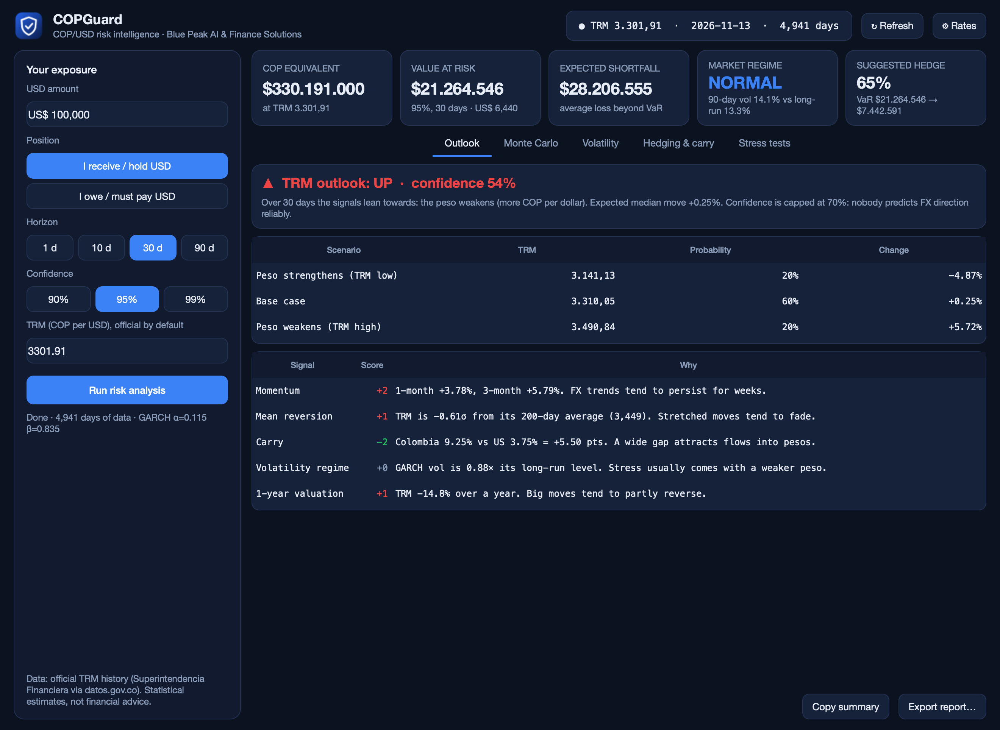
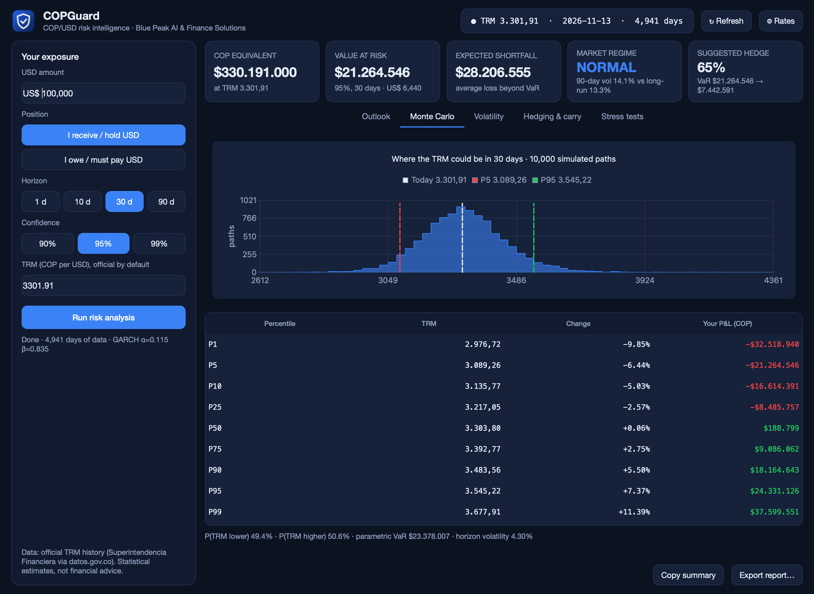
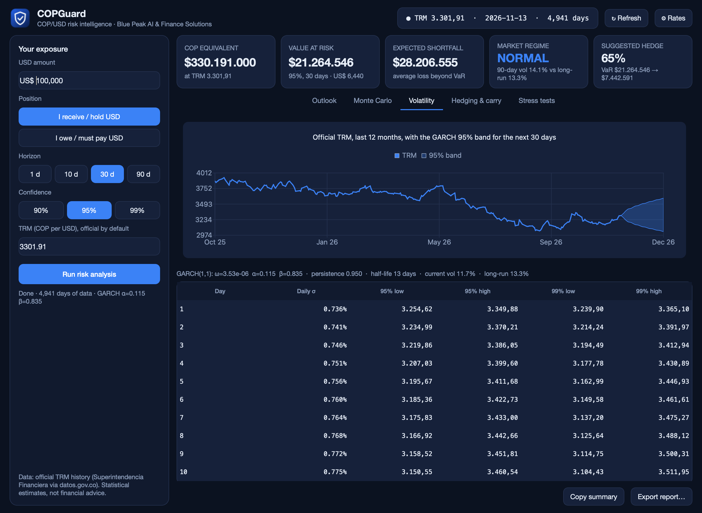
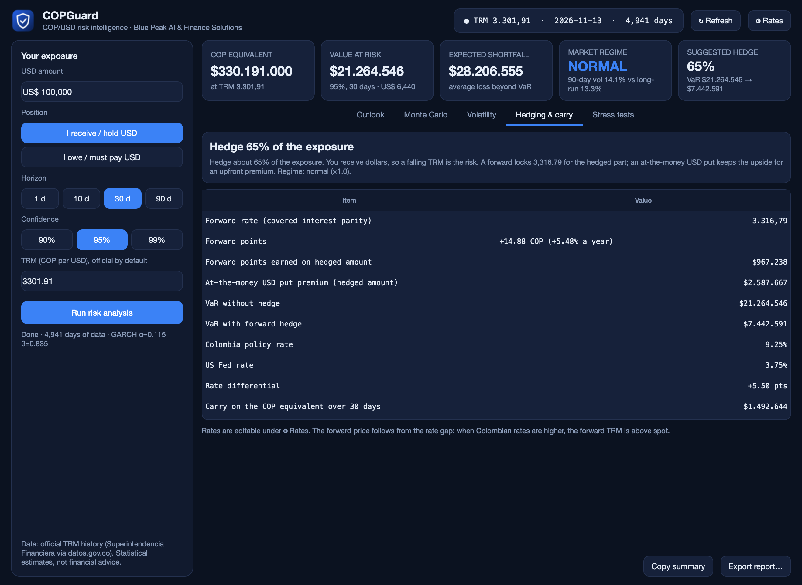
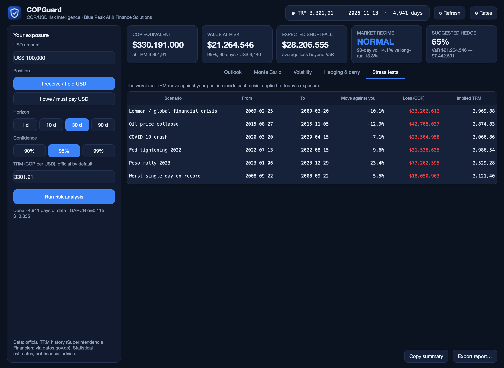

<p align="center">
  
</p>

<h1 align="center">COPGuard</h1>

<p align="center">
  <b>COP/USD exchange-rate risk, measured properly.</b><br>
  A desktop app that tells a Colombian company or investor how much the peso–dollar rate could cost them, and how to hedge it.
</p>

<p align="center">
  
  
  
  
  
</p>



## Why

If you get paid in dollars and spend in pesos (an exporter, a freelancer with US clients, an investor), a 10% move in the TRM is a 10% hit to your income. Most tools give a gut feeling about where the dollar is going. COPGuard puts a number on the risk instead, using 20 years of the official exchange rate:

- **How much could I lose?** Value at Risk and expected shortfall, in pesos.
- **How likely is a big move?** 10,000 simulated paths for the TRM.
- **What would a crisis do to me?** The real moves from 2008, 2015, 2020, 2022 and 2023, replayed on today's position.
- **What should I do about it?** A hedge ratio, the forward price, and what an option would cost.

## Features

| | |
|---|---|
| **Official data** | The full TRM history from the Superintendencia Financiera (datos.gov.co), about 4,900 business days since 2006. No API key. Cached, so it also works offline. |
| **GARCH(1,1)** | Volatility model fitted by maximum likelihood on the real series each time you run it. It reports persistence, half-life, and current vs long-run volatility. |
| **Monte Carlo** | 10,000 paths with filtered historical simulation: shocks are resampled from the model's own residuals, so the fat tails of the real peso carry into the forecast. |
| **VaR and CVaR** | At 90/95/99%, over 1 to 90 days, with a parametric VaR alongside for comparison. |
| **Hedging** | Forward rate from covered interest parity, an at-the-money option price (Garman-Kohlhagen), and VaR before and after hedging. |
| **Stress tests** | The worst real move against *your* side of the trade inside each crisis window. |
| **Outlook** | Five transparent signals (momentum, mean reversion, carry, volatility regime, 1-year valuation). Confidence is capped at 70%, and the scenario probabilities add up to 100%. |
| **Reports** | Copy a summary or export a Markdown report. Works for receivables *and* payables. |

<table>
  <tr>
    <td></td>
    <td></td>
  </tr>
  <tr>
    <td></td>
    <td></td>
  </tr>
</table>

## Install

**Download:** grab the latest build for Mac or Windows from [Releases](../../releases).

> On macOS the app isn't notarized yet. The first time, right-click it and choose **Open**.

**From source:**

```bash
git clone https://github.com/ianjacobo2009-hub/copguard.git
cd copguard
python3 -m venv .venv && source .venv/bin/activate
pip install -r requirements.txt
python -m copguard                       # desktop app
python -m copguard --cli --usd 250000 --days 90 --confidence 0.99   # report in the terminal
```

Interest rates (Banco de la República and the Fed) are used for the forward and the carry. Update them under **⚙ Rates** when the central banks move.

## How the numbers are made

1. **Returns.** Daily log changes of the TRM. Each official rate is assigned to the days it was actually in force, so weekend rates don't erase Mondays.
2. **Volatility.** GARCH(1,1), `σ²ₜ₊₁ = ω + α·εₜ² + β·σ²ₜ`, fitted on the last ~10 years. The forecast mean-reverts to `ω / (1 − α − β)`.
3. **Simulation.** Each path draws standardized residuals from history and updates the variance day by day, for 10,000 paths.
4. **Risk.** P&L = exposure × (TRM at the horizon − TRM today), with the sign flipped for a payable. VaR is the loss at the chosen percentile; CVaR is the average loss beyond it.
5. **Hedge.** Forward `F = S · (1 + i_COP·t) / (1 + i_USD·t)`. The hedge ratio scales with your confidence level and the volatility regime.
6. **Stress.** Peak-to-trough (or trough-to-peak) of the real TRM inside each crisis window, applied to today's exposure.

Run the tests with `pip install pytest && python -m pytest -q`. They check that GARCH recovers known parameters, VaR is below CVaR, scenarios add up to 100%, hedging lowers VaR, payables mirror receivables, and option put-call parity holds.

## From prototype to software

COPGuard started as a web prototype. This version is a full rewrite as a desktop app, and it fixes problems the prototype had:

- The forecast used an old exchange rate (3,778) while the live TRM was 3,288. Every number now comes from the same live rate.
- Scenario probabilities added up to 108%. They now come from the simulation and sum to 100%.
- Volatility, stress-test probabilities and the risk split were fixed numbers. They are now computed from the data on every run.

## Project layout

```
copguard/
  data.py     official TRM download, cleaning, cache, settings
  models.py   GARCH, simulation, VaR/CVaR, regime, carry, hedging, stress tests, outlook
  report.py   Markdown report
  app.py      the desktop interface (PySide6)
tests/        model tests
copguard.spec PyInstaller build (Mac .app / Windows .exe)
```

## Disclaimer

COPGuard gives statistical estimates from historical data. It is not financial advice, and nobody can predict exchange rates reliably.

---

Built by **Ian** · [Blue Peak AI & Finance Solutions](https://github.com/ianjacobo2009-hub)
